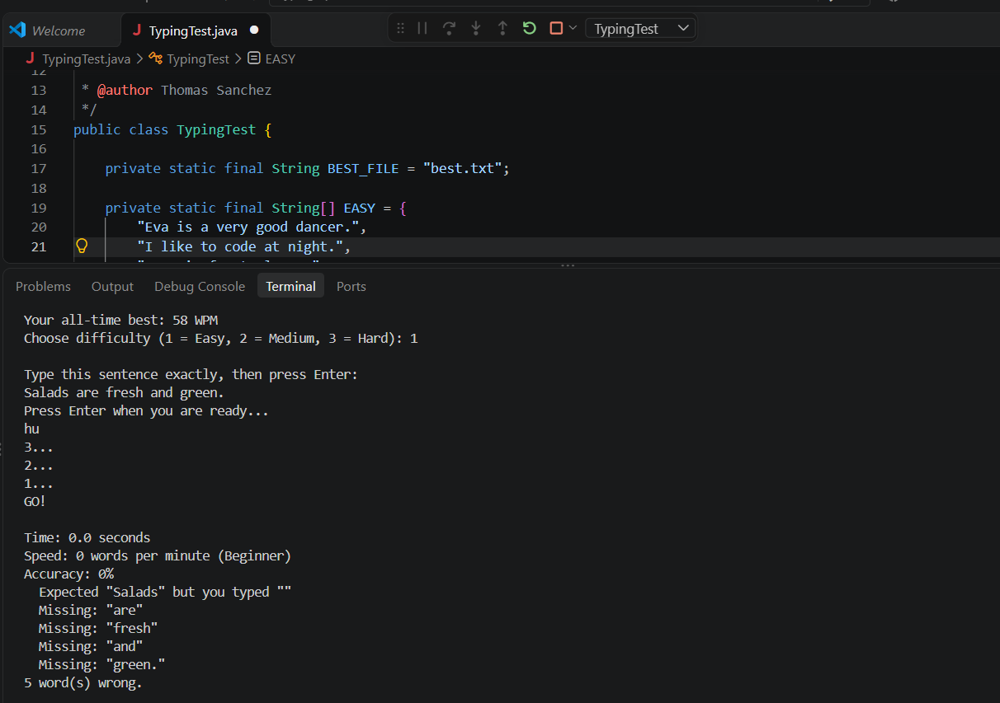

# Typing Speed Test

A Java console app that times how fast you type a sentence and reports your words per minute, accuracy, and every word you got wrong.

## Features
- Easy, Medium, and Hard difficulty levels
- 3-2-1 countdown before each round
- Mistake report showing every wrong or missing word
- Average WPM and a rating (Beginner, Good, Fast, Pro)
- All-time personal best saved to a file

## Java concepts used
Scanner, arrays, ArrayList, while and for loops, methods, printf, string methods, try/catch, and file I/O

## How to run
1. Download `TypingTest.java`
2. Run `javac TypingTest.java`
3. Run `java TypingTest`

## What I'd add next
- A leaderboard that saves scores for multiple players
- A graphical window instead of the terminal

